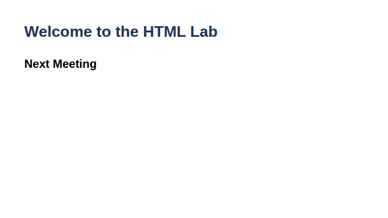
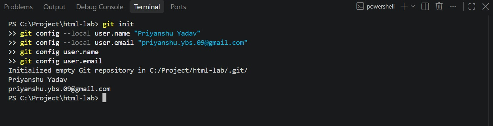
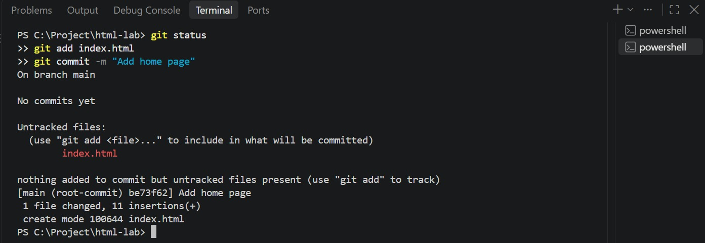
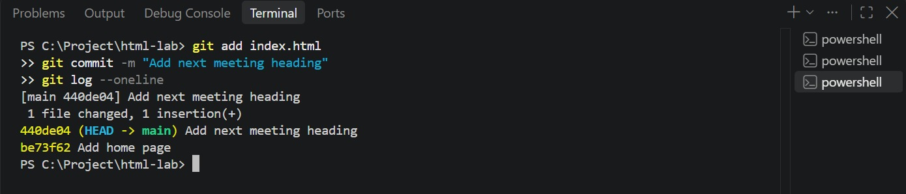

# Lab 1: Starting a Git Repository

**Name:** Priyanshu Yadav  
**Roll No:** 2410303363  
**Student ID:** BCS2024318  
**Course:** B.Tech CSE (3rd Year) - HTML & CSS Development Lab (BCS554)

## Aim
Start a Git repository for your lab folder and save your work with commits.

## Tasks
1. Create folder `html-lab`, run `git init`, set name/email with `git config --local`, show them.
2. Create `index.html` with one h1, run `git status`, add and commit with message "Add home page".
3. Add an h2 below the h1, commit with "Add next meeting heading", run `git log --oneline`.

## Files
- `index.html`
- `style.css`

## Output
**index.html (page output)**



## Terminal Screenshots

**Task 1: git init and git config**



**Task 2: git status, git add, git commit**



**Task 3: second commit and git log --oneline**




## Commands used
```bash
mkdir html-lab && cd html-lab
git init
git config --local user.name "Priyanshu Yadav"
git config --local user.email "you@example.com"
git config user.name
git config user.email

# create index.html (see index.html in this folder - first with only the h1)
git status
git add index.html
git commit -m "Add home page"

# add the h2 to index.html
git add index.html
git commit -m "Add next meeting heading"
git log --oneline
```
`index.html` in this folder is the final version (h1 + h2).
