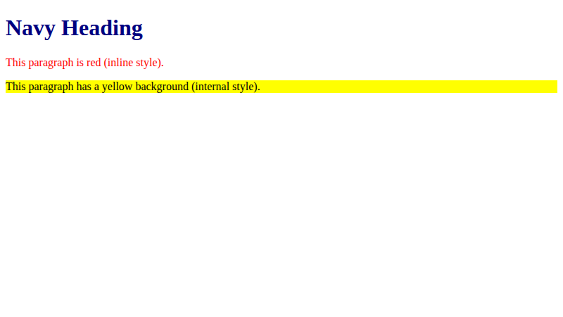
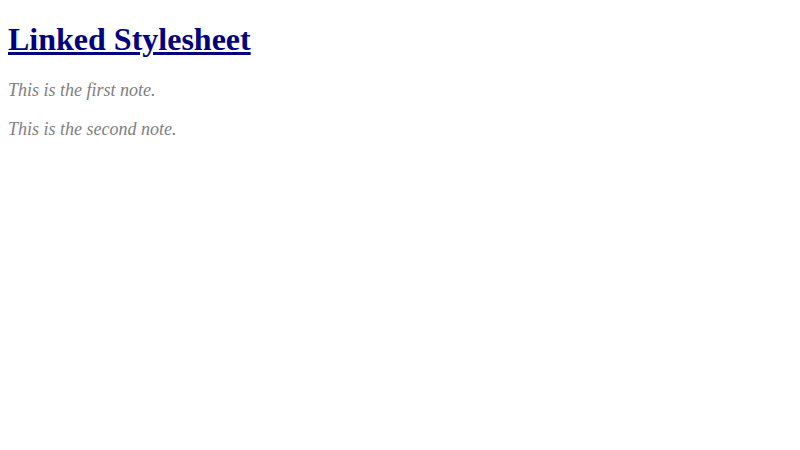

# Lab 10: CSS Fundamentals

**Name:** Priyanshu Yadav  
**Roll No:** 2410303363  
**Student ID:** BCS2024318  
**Course:** B.Tech CSE (3rd Year) - HTML & CSS Development Lab (BCS554)

## Aim
Apply CSS in three ways (inline, internal and linked) and use selectors and text styles.

## Tasks
1. `inline-internal.html` - internal style, inline style, class highlight.
2. `style.css` - h1, .note, #title, p rules.
3. `linked.html` - links style.css.

## Files
- `index.html`
- `style.css`
- `inline-internal.html`
- `linked.html`

## Output
**inline-internal.html**

**linked.html**

