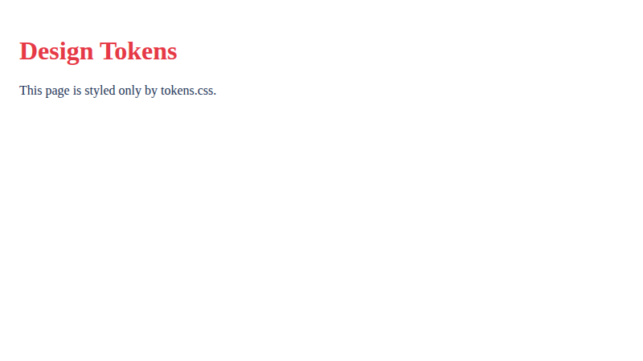
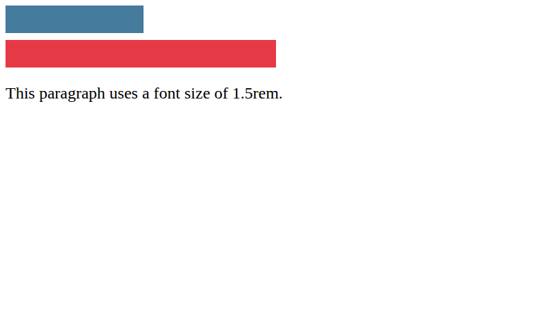
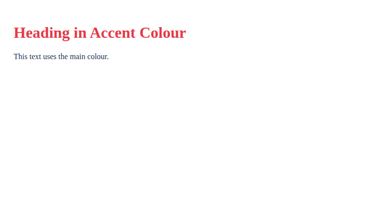

# Lab 11: Units and CSS Variables

**Name:** Priyanshu Yadav  
**Roll No:** 2410303363  
**Student ID:** BCS2024318  
**Course:** B.Tech CSE (3rd Year) - HTML & CSS Development Lab (BCS554)

## Aim
Use CSS units and store colours and spacing in variables.

## Tasks
1. `units.html` - 200px box, 50% box, 1.5rem text.
2. `variables.html` - :root variables with var().
3. `tokens.css` - design tokens (+ `tokens-demo.html` to test it).

## Files
- `index.html`
- `style.css`
- `units.html`
- `variables.html`
- `tokens.css`
- `tokens-demo.html`

## Output
**tokens-demo.html**

**units.html**

**variables.html**

