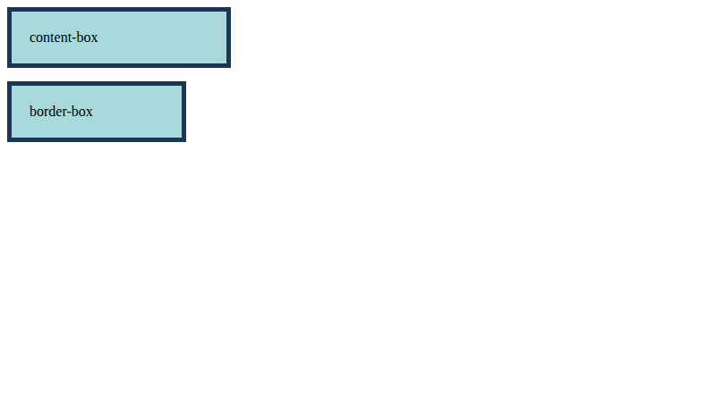
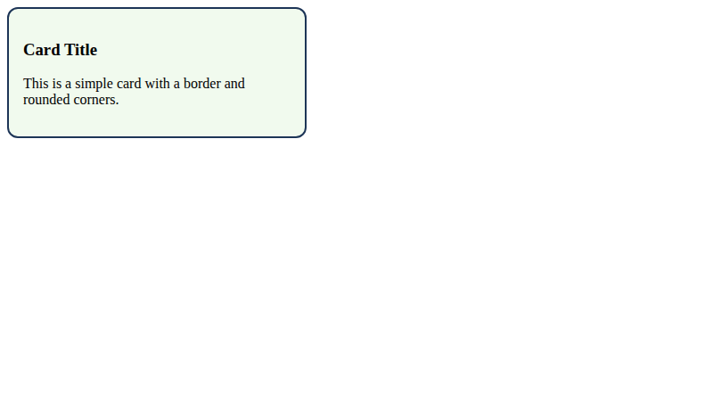
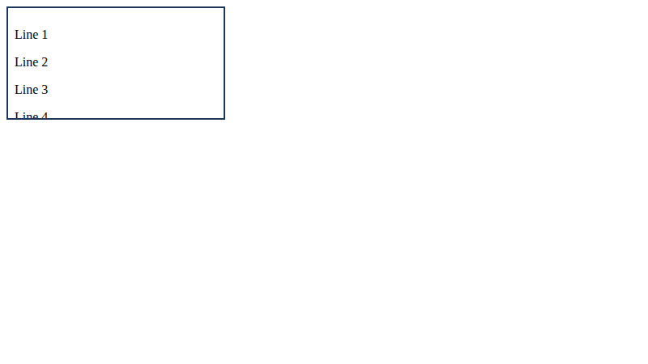

# Lab 12: Box Model, Cards and Scrolling

**Name:** Priyanshu Yadav  
**Roll No:** 2410303363  
**Student ID:** BCS2024318  
**Course:** B.Tech CSE (3rd Year) - HTML & CSS Development Lab (BCS554)

## Aim
Compare the box sizing types, style a card and make a box scroll.

## Tasks
1. `box-model.html` - content-box vs border-box.
2. `card.html` - styled card.
3. `scroll.html` - 120px box with overflow auto.

## Files
- `index.html`
- `style.css`
- `box-model.html`
- `card.html`
- `scroll.html`

## Output
**box-model.html**

**card.html**

**scroll.html**

