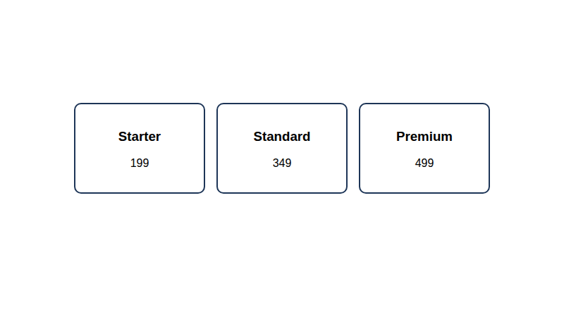
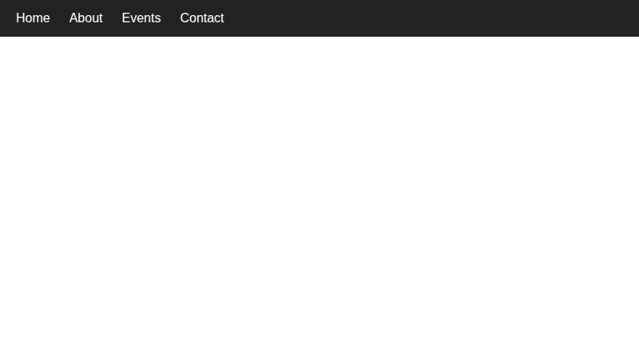
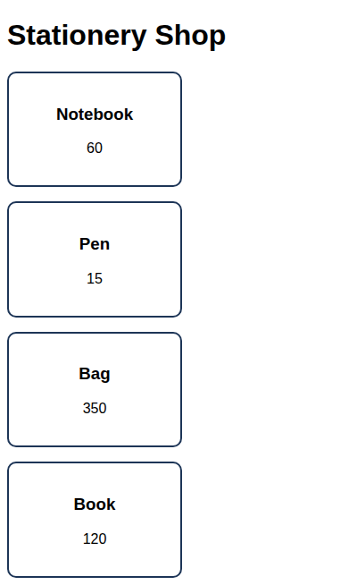
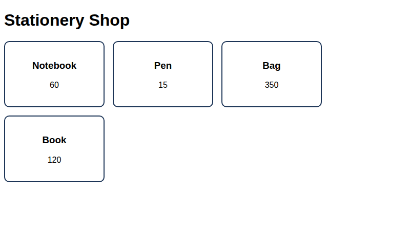

# Lab 13: Flexbox Layouts

**Name:** Priyanshu Yadav  
**Roll No:** 2410303363  
**Student ID:** BCS2024318  
**Course:** B.Tech CSE (3rd Year) - HTML & CSS Development Lab (BCS554)

## Aim
Lay out a navigation bar, centred cards and cards that wrap, using Flexbox.

## Tasks
1. `nav-flex.html` - flex nav bar.
2. `centred-cards.html` - 3 cards centred in a row.
3. `wrapping-cards.html` - flex-wrap cards.

## Files
- `index.html`
- `style.css`
- `nav-flex.html`
- `centred-cards.html`
- `wrapping-cards.html`

## Output
**centred-cards.html**

**nav-flex.html**

**wrapping-cards.html (narrow window)**

**wrapping-cards.html (wide window)**

