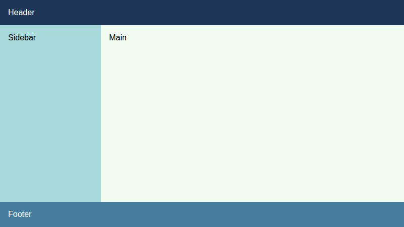
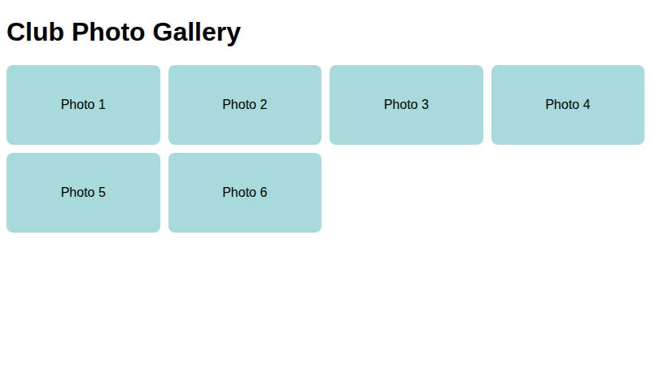
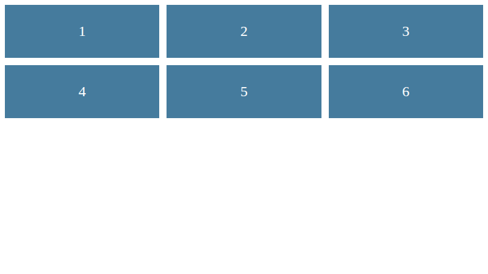

# Lab 14: CSS Grid Layouts

**Name:** Priyanshu Yadav  
**Roll No:** 2410303363  
**Student ID:** BCS2024318  
**Course:** B.Tech CSE (3rd Year) - HTML & CSS Development Lab (BCS554)

## Aim
Make a grid with equal columns, a responsive gallery and a layout with named areas.

## Tasks
1. `grid-first.html` - 3 equal columns, 12px gap.
2. `gallery.html` - repeat(auto-fill, minmax(150px,1fr)).
3. `dashboard-areas.html` - grid-template-areas layout.

## Files
- `index.html`
- `style.css`
- `grid-first.html`
- `gallery.html`
- `dashboard-areas.html`

## Output
**dashboard-areas.html**

**gallery.html**

**grid-first.html**

