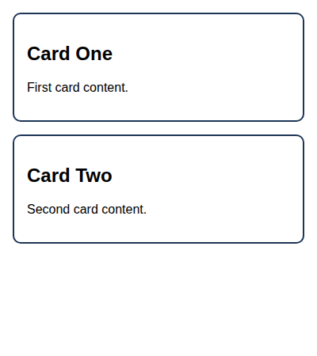
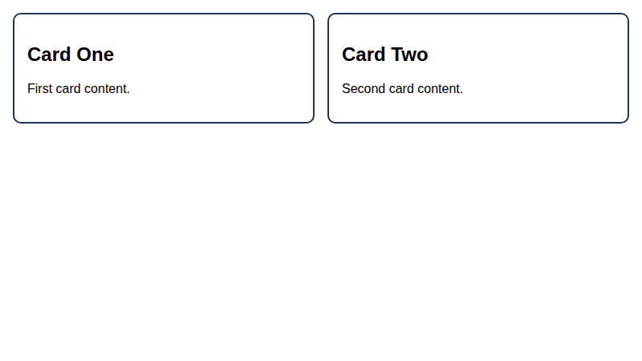
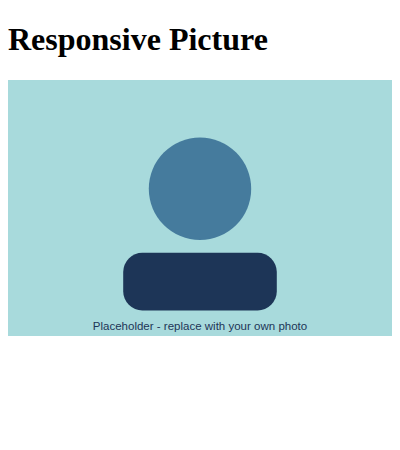
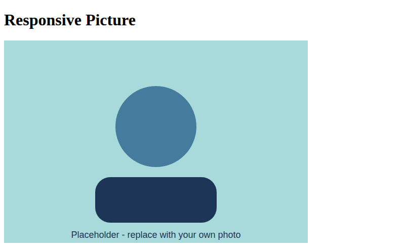
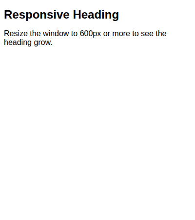
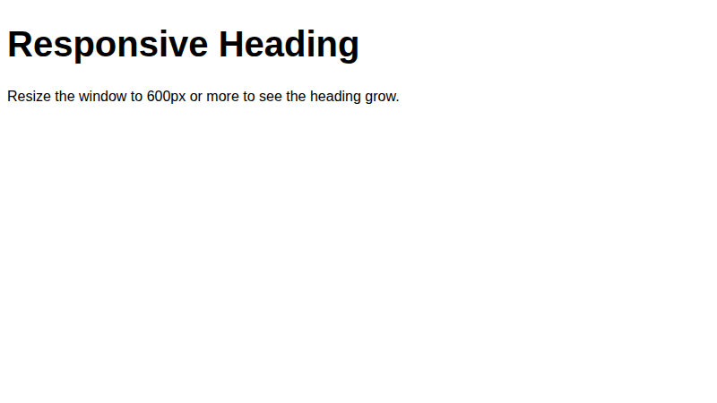

# Lab 15: Responsive Pages with Media Queries

**Name:** Priyanshu Yadav  
**Roll No:** 2410303363  
**Student ID:** BCS2024318  
**Course:** B.Tech CSE (3rd Year) - HTML & CSS Development Lab (BCS554)

## Aim
Use a media query to change a layout, make a picture scale, and set text sizes with rem.

## Tasks
1. `mobile-first.html` - viewport meta, cards stack, 2 per row at 600px+.
2. `responsive-image.html` - max-width 100%, height auto.
3. `responsive-text.html` - rem sizes + media query for h1.

## Files
- `index.html`
- `style.css`
- `mobile-first.html`
- `responsive-image.html`
- `responsive-text.html`

## Output
**mobile-first.html (narrow window)**

**mobile-first.html (wide window)**

**responsive-image.html (narrow window)**

**responsive-image.html (wide window)**

**responsive-text.html (narrow window)**

**responsive-text.html (wide window)**

> `images/photo.svg` is a placeholder. Use the file name your instructor gives you.
