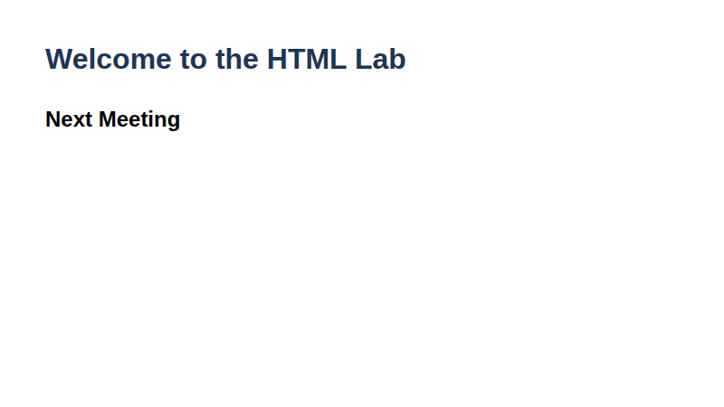
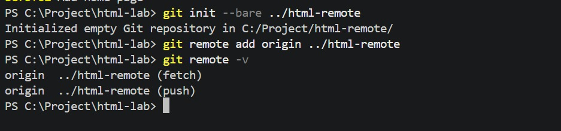
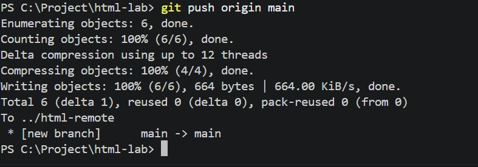
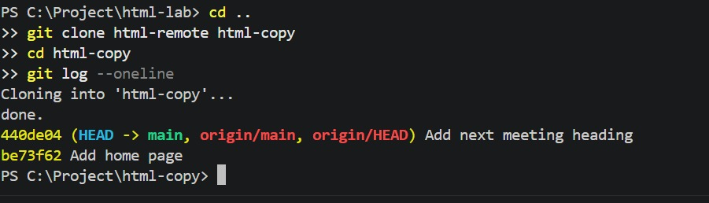

# Lab 2: Pushing and Cloning a Repository

**Name:** Priyanshu Yadav  
**Roll No:** 2410303363  
**Student ID:** BCS2024318  
**Course:** B.Tech CSE (3rd Year) - HTML & CSS Development Lab (BCS554)

## Aim
Send commits to a second repository on your computer and make a copy with clone.

## Tasks
1. Create bare repo `../html-remote`, add it as `origin`, run `git remote -v`.
2. Push with `git push origin main` (or `master`).
3. Clone `html-remote` into `html-copy` and run `git log --oneline`.

## Files
- `index.html`
- `style.css`

## Output
**index.html (page output)**



## Terminal Screenshots

**Task 1: git init --bare, git remote add, git remote -v**



**Task 2: git push origin main**



**Task 3: git clone and git log --oneline in html-copy**




## Commands used
```bash
cd html-lab
git init --bare ../html-remote
git remote add origin ../html-remote
git remote -v
git push origin main        # use master if git status says "On branch master"

cd ..
git clone html-remote html-copy
cd html-copy
git log --oneline
```
Same commits as in `html-lab` should be visible. (`index.html` here is the copied page.)
