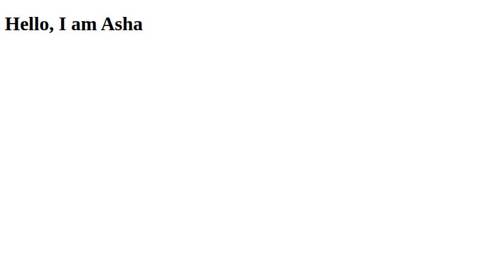
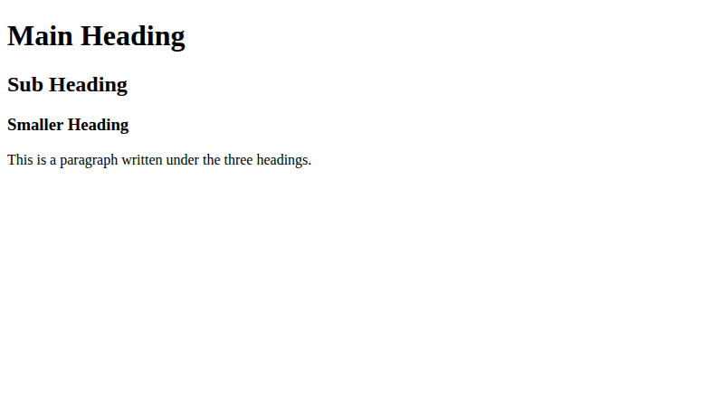
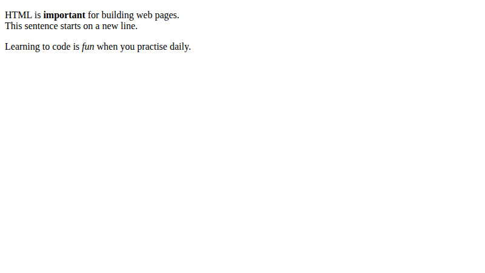

# Lab 3: Your First HTML Page

**Name:** Priyanshu Yadav  
**Roll No:** 2410303363  
**Student ID:** BCS2024318  
**Course:** B.Tech CSE (3rd Year) - HTML & CSS Development Lab (BCS554)

## Aim
Write a first HTML page with a title, headings and a paragraph, and format some text.

## Tasks
1. `first.html` - title My First Page, h1 "Hello, I am Asha".
2. `headings.html` - h1, h2, h3 and a paragraph.
3. `text-format.html` - two paragraphs, strong, em and a line break.

## Files
- `index.html`
- `style.css`
- `first.html`
- `headings.html`
- `text-format.html`

## Output
**first.html**

**headings.html**

**text-format.html**

