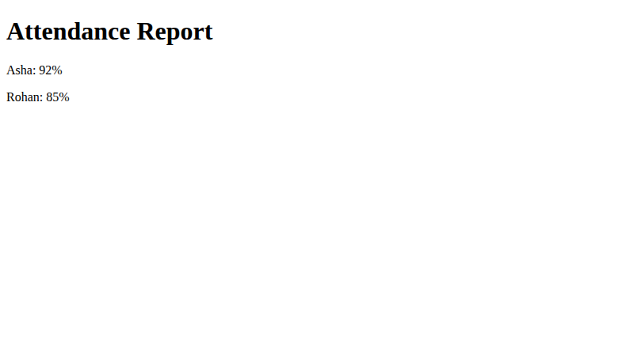
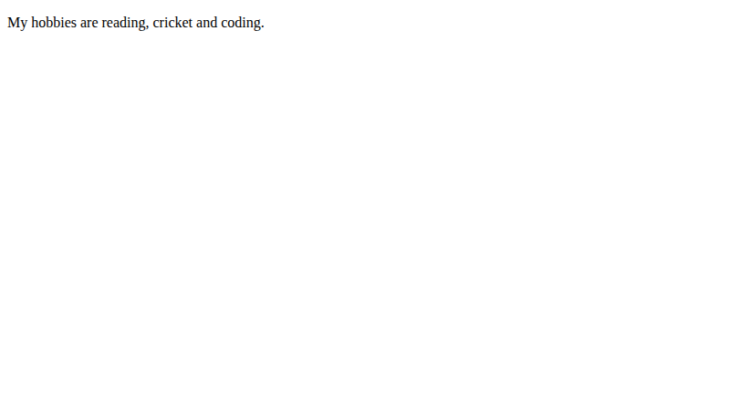
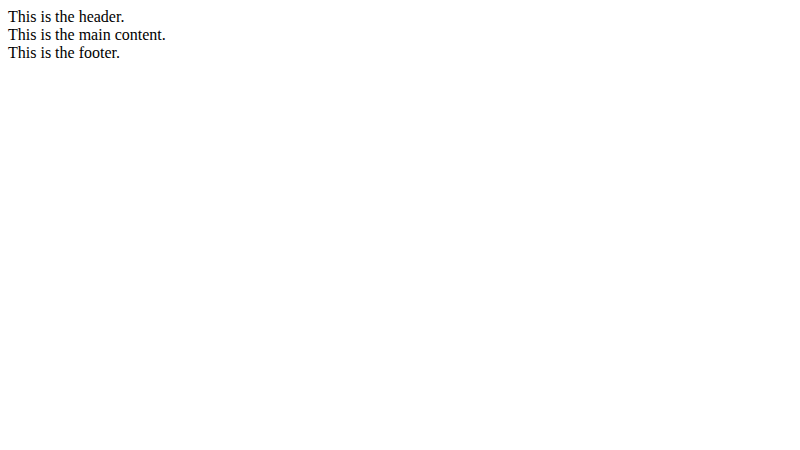

# Lab 4: Divs, Attributes and a Small Fix

**Name:** Priyanshu Yadav  
**Roll No:** 2410303363  
**Student ID:** BCS2024318  
**Course:** B.Tech CSE (3rd Year) - HTML & CSS Development Lab (BCS554)

## Aim
Group parts of a page with div elements, add a data attribute, and fix a broken page.

## Tasks
1. `layout.html` - div blocks with classes header, main, footer.
2. `attributes.html` - div id=profile with a paragraph having data-topic="hobbies".
3. `attendance-fixed.html` - corrected broken page.

## Files
- `index.html`
- `style.css`
- `layout.html`
- `attributes.html`
- `attendance-fixed.html`

## Output
**attendance-fixed.html**

**attributes.html**

**layout.html**

## Errors fixed in `attendance-fixed.html`
1. `<h1>` was never closed -> added `</h1>`.
2. `
Asha: 92%
` had an opening `
` where a closing `
` was needed -> fixed to `
`.
(Also added `lang` and `charset`/viewport meta for good practice.)
