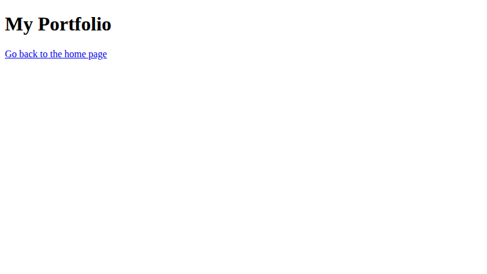

# Lab 5: Links and Images

**Name:** Priyanshu Yadav  
**Roll No:** 2410303363  
**Student ID:** BCS2024318  
**Course:** B.Tech CSE (3rd Year) - HTML & CSS Development Lab (BCS554)

## Aim
Link two pages together and add a picture with alt text.

## Tasks
1. `home.html` - heading and link "portfolio" to portfolio.html.
2. `portfolio.html` - heading and link back to home.html.
3. `portfolio-image.html` - 200x200 image from images folder with alt text.

## Files
- `index.html`
- `style.css`
- `home.html`
- `portfolio.html`
- `portfolio-image.html`

## Output
**home.html**

**portfolio-image.html**

**portfolio.html**

> **Note:** `images/photo.svg` is a placeholder. Use the file name your instructor gives you and update the `src` in `portfolio-image.html`.
