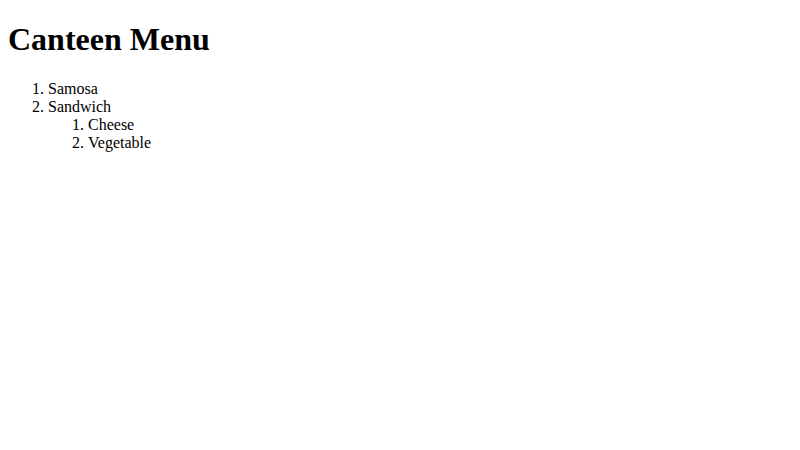
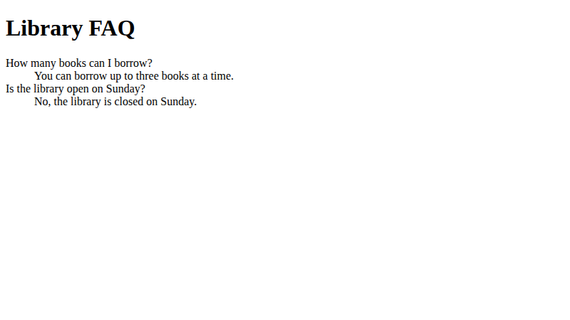
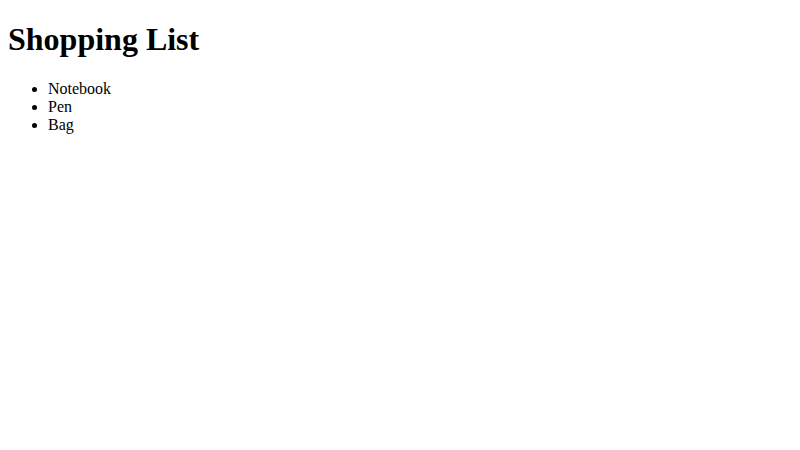

# Lab 6: Types of HTML Lists

**Name:** Priyanshu Yadav  
**Roll No:** 2410303363  
**Student ID:** BCS2024318  
**Course:** B.Tech CSE (3rd Year) - HTML & CSS Development Lab (BCS554)

## Aim
Make a bulleted list, a numbered list with a nested list, and a description list.

## Tasks
1. `shopping-list.html` - unordered list: Notebook, Pen, Bag.
2. `canteen-menu.html` - ordered list with nested list under Sandwich.
3. `faq.html` - description list (dl, dt, dd).

## Files
- `index.html`
- `style.css`
- `shopping-list.html`
- `canteen-menu.html`
- `faq.html`

## Output
**canteen-menu.html**

**faq.html**

**shopping-list.html**

