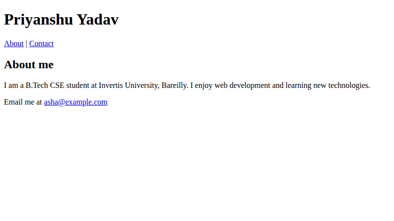

# Lab 7: About Me Page

**Name:** Priyanshu Yadav  
**Roll No:** 2410303363  
**Student ID:** BCS2024318  
**Course:** B.Tech CSE (3rd Year) - HTML & CSS Development Lab (BCS554)

## Aim
Build a short About Me page with semantic tags, an about section and a contact link.

## Tasks
1. `about-me.html` - header (h1 + nav), empty main, empty footer.
2. Add section#about with h2 and paragraph inside main.
3. Add paragraph with mailto link in footer#contact.

## Files
- `index.html`
- `style.css`
- `about-me.html`

## Output
**about-me.html**

> Change the name and email to your own.
