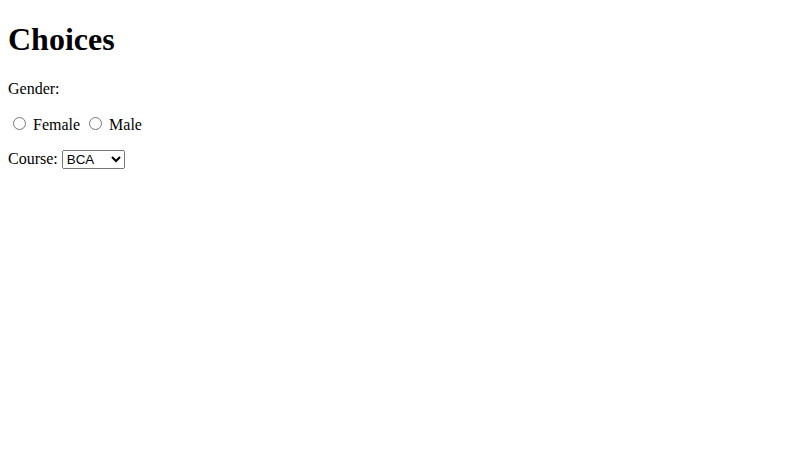
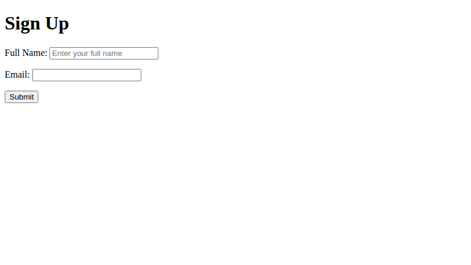
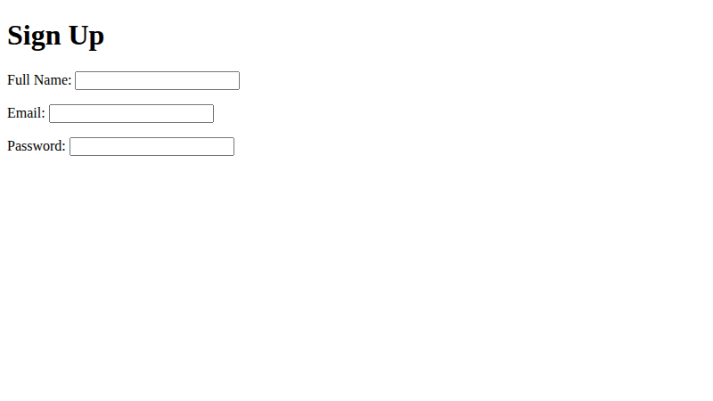

# Lab 8: Sign-Up Forms and Choices

**Name:** Priyanshu Yadav  
**Roll No:** 2410303363  
**Student ID:** BCS2024318  
**Course:** B.Tech CSE (3rd Year) - HTML & CSS Development Lab (BCS554)

## Aim
Make a labelled form with text, email and password fields, choices and a submit button.

## Tasks
1. `signup.html` - form (post, thanks.html) with labelled name, email, password.
2. `choices.html` - radio buttons (Female/Male) and course dropdown.
3. `signup-required.html` - required fields, placeholder, Submit button.

## Files
- `index.html`
- `style.css`
- `signup.html`
- `choices.html`
- `signup-required.html`

## Output
**choices.html**

**signup-required.html**

**signup.html**

