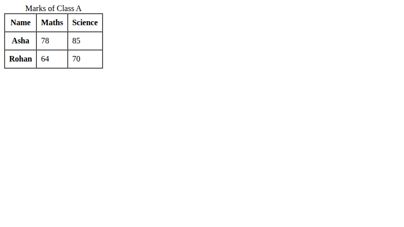
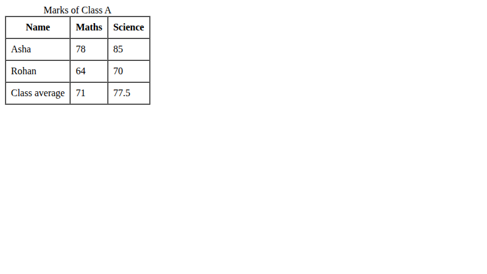
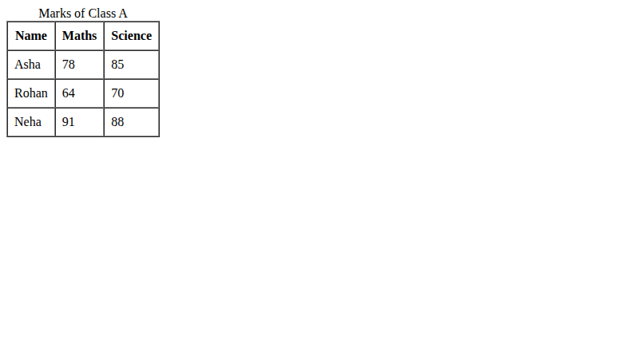

# Lab 9: Tables with Headers and Footers

**Name:** Priyanshu Yadav  
**Roll No:** 2410303363  
**Student ID:** BCS2024318  
**Course:** B.Tech CSE (3rd Year) - HTML & CSS Development Lab (BCS554)

## Aim
Build a table with a caption, header, rows and a footer, and add scope attributes.

## Tasks
1. `marks.html` - caption, thead, tbody with 3 students.
2. `marks-average.html` - Asha & Rohan with tfoot class average.
3. `marks-accessible.html` - scope="col" and scope="row".

## Files
- `index.html`
- `style.css`
- `marks.html`
- `marks-average.html`
- `marks-accessible.html`

## Output
**marks-accessible.html**

**marks-average.html**

**marks.html**

Averages: Maths = (78+64)/2 = **71**, Science = (85+70)/2 = **77.5**
